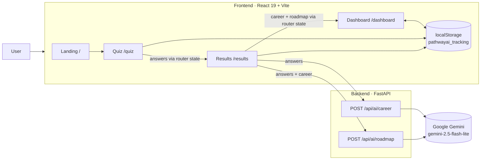

# PathwayAI

**AI-powered tech career guidance.** Answer a short quiz, get three personalized tech-career matches, and turn the one you pick into a step-by-step learning roadmap you can track.

> **Project status: early MVP.** The core flow (quiz → AI career matches → AI roadmap → progress dashboard) works end-to-end locally. Accounts, server-side persistence, the resume analyzer and the AI coach are **planned, not built**. See [Roadmap](#roadmap) and [`ROADMAP.md`](ROADMAP.md).

---

## Screenshots

> _Placeholders — add images to `docs/screenshots/` and update the links._

| Landing | Quiz | Career matches | Dashboard |
|---|---|---|---|
|  |  |  |  |

---

## Features

### ✅ Implemented
- **Career quiz** — 8 animated questions (multiple choice, sliders, free text) with a progress bar.
- **AI career matches** — Gemini suggests 3 technology careers with match %, salary range, growth outlook, education, key skills and a personalized reason.
- **Compare careers** — side-by-side comparison of 2–3 suggestions.
- **Regenerate** suggestions, or choose "None of these" to retake the quiz.
- **AI roadmap** — up to 5 actionable steps, each with a time estimate, tasks and learning resources.
- **Progress dashboard** — interactive timeline (expand steps, mark done/undo) plus Career Readiness, Employability and Momentum meters with a top recommendation.
- **Export** — download results as PDF or print.
- **Home hub (`/home`)** — an honest starting page: quiz entry point, an empty "Your roadmaps" state (nothing is saved until accounts exist) and clearly labelled planned features.
- **Local activity tracking** — events, metrics and progress stored in the browser (`localStorage`).

### 🟡 Partially implemented
- **Progress tracking** — works within a session, but isn't scoped per roadmap and roadmaps aren't persisted (known bugs, see [`docs/technical-debt.md`](docs/technical-debt.md)).

### 🗺️ Planned
- Accounts and saved roadmaps (PostgreSQL), shareable roadmap links
- Resume analysis and skill-gap detection
- AI career coach (chat)
- Streaming generation, grounded resources and real salary data
- Tests, CI/CD, containerized deployment

---

## Architecture



- The **frontend** is a single-page React app. Data moves between pages through React Router navigation state. Progress and analytics live in `localStorage`.
- The **backend** is a thin FastAPI service that holds the Gemini API key server-side, builds prompts and returns parsed JSON.
- There is currently **no database and no authentication**.

More: [`docs/architecture.md`](docs/architecture.md).

---

## AI workflow

1. **Career matching** — quiz answers are formatted into a prompt that requires strict JSON: exactly 3 **tech-industry** careers with `title, reason, match_score (70–95), salary_range, growth_rate, education, skills`, plus a short supportive `explanation`.
2. **Roadmap generation** — answers plus the chosen career produce ≤5 beginner-friendly steps with `title, description, time, resources[{name,url}], tasks[]`.
3. The backend parses the model output as JSON and returns it. The frontend normalizes and renders it.

Current limitations (being addressed): no response schema enforcement, no streaming, and salary figures and resource URLs are generated by the model, not retrieved from a verified source. See [`docs/ai-system.md`](docs/ai-system.md).

---

## Tech stack

| Layer | Technology |
|---|---|
| Frontend | React 19, Vite 7, React Router 7, framer-motion, lucide-react, html2pdf.js |
| Backend | Python, FastAPI, Uvicorn, Pydantic 2 |
| AI | Google Gemini (`google-genai` SDK, `gemini-2.5-flash-lite`) |
| Storage | Browser `localStorage` (server DB planned) |
| Tooling | ESLint 9 |

---

## Getting started

### Prerequisites
- Node.js 20+ and npm
- Python 3.11+
- A Google Gemini API key ([Google AI Studio](https://aistudio.google.com/))

### 1. Backend
```bash
cd backend
python -m venv .venv
# Windows: .venv\Scripts\activate   ·   macOS/Linux: source .venv/bin/activate
pip install -r requirements.txt
```
Create `backend/.env`:
```env
GEMINI_API_KEY=your_key_here
```
Run:
```bash
uvicorn main:app --reload --port 8000
```

### 2. Frontend
```bash
cd frontend
npm install
npm run dev          # http://localhost:5173
```

> The frontend currently calls `http://127.0.0.1:8000` directly and the backend only allows CORS from `http://localhost:5173`. Both are hard-coded today. Making them configurable is a top-priority task.

### Environment variables

| Variable | Where | Required | Status | Description |
|---|---|---|---|---|
| `GEMINI_API_KEY` | `backend/.env` | Yes | In use | Google Gemini API key |
| `VITE_API_URL` | `frontend/.env` | — | **Planned** | Backend base URL |
| `ALLOWED_ORIGINS` | `backend/.env` | — | **Planned** | Comma-separated CORS origins |

### Scripts (frontend)
| Command | Description |
|---|---|
| `npm run dev` | Start the Vite dev server |
| `npm run build` | Production build to `dist/` |
| `npm run preview` | Preview the production build |
| `npm run lint` | Run ESLint |

---

## Deployment

Not deployed yet. The planned target is a static frontend (Vercel, Netlify or Render Static) plus a containerized FastAPI service (Render or Fly.io), with environment-based configuration. See [`docs/deployment.md`](docs/deployment.md).

---

## Folder structure

```
roadmap-ai/
├── backend/
│   ├── main.py              # FastAPI app: /api/ai/career, /api/ai/roadmap
│   └── requirements.txt
├── frontend/
│   └── src/
│       ├── pages/           # Landing, Home, Quiz, Results, Dashboard
│       ├── components/      # RoadmapTimeline, RadialMeter, CareerCompareModal, ShareModal, ThemeGate
│       ├── lib/             # trackingEngine, scoringEngine
│       ├── data/            # quiz questions, tracking schema, career details
│       └── index.css        # global styles
├── docs/                    # architecture, API, AI, design, decisions (ADRs)…
├── CLAUDE.md                # project memory for AI-assisted development
├── ROADMAP.md
└── SESSION.md
```

---

## Technical decisions

Key choices and their trade-offs are recorded as ADRs in [`docs/decisions.md`](docs/decisions.md). Highlights:
- **FastAPI proxy for AI** keeps the API key off the client and gives one place for validation, rate limiting and caching.
- **Gemini Flash-Lite** was chosen for low latency and low cost on structured, short outputs.
- **localStorage first** made an account-free MVP possible. Server persistence is the next architectural step.
- **Tech-only scope**: the product narrowed from general careers to technology careers to give deeper, more accurate guidance.

---

## Roadmap

Short version (full, estimated and prioritized: [`ROADMAP.md`](ROADMAP.md)):
1. **Foundation:** version control, cleanup, env config, bug fixes, AI output validation, backend hardening
2. **Production baseline:** tests, CI, Docker, deployment, error tracking
3. **Persistence:** auth, PostgreSQL, saved and shareable roadmaps
4. **AI depth:** streaming, grounded resources (RAG), resume analysis, evaluation harness
5. **Differentiators:** AI coach with tool calling, job-market data, mock interviews, EN/FR

---

## Documentation

| Doc | Contents |
|---|---|
| [`docs/architecture.md`](docs/architecture.md) | System overview and data flow |
| [`docs/frontend.md`](docs/frontend.md) | Pages, components, state, styling |
| [`docs/backend.md`](docs/backend.md) | FastAPI service |
| [`docs/api.md`](docs/api.md) | Endpoint reference |
| [`docs/ai-system.md`](docs/ai-system.md) | Prompts, parsing, planned AI improvements |
| [`docs/database.md`](docs/database.md) | Current storage and planned schema |
| [`docs/ui-design.md`](docs/ui-design.md) | Design language and UI backlog |
| [`docs/testing.md`](docs/testing.md) | Test strategy |
| [`docs/deployment.md`](docs/deployment.md) | Deployment plan |
| [`docs/decisions.md`](docs/decisions.md) | Architecture Decision Records |
| [`docs/technical-debt.md`](docs/technical-debt.md) | Known issues by severity |
