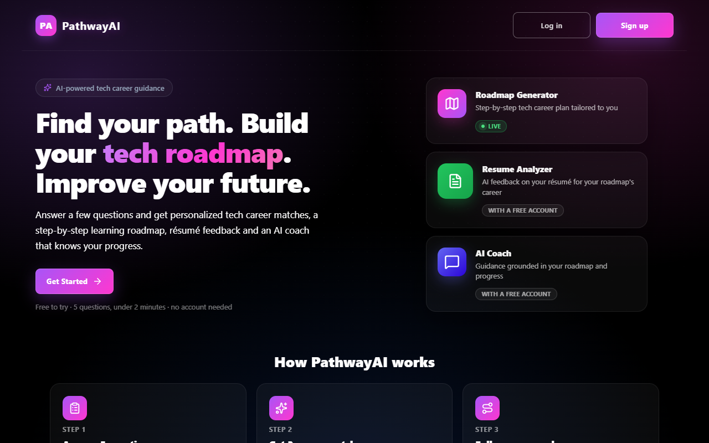
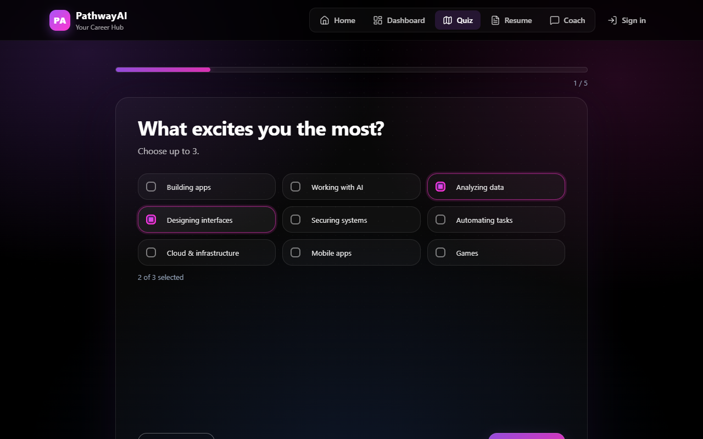
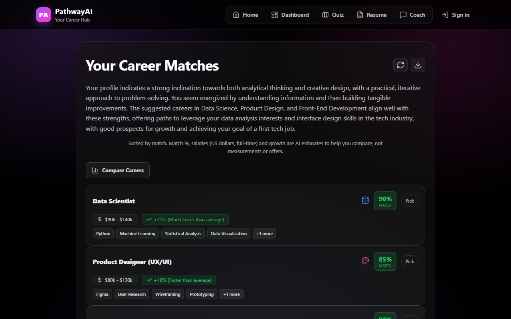
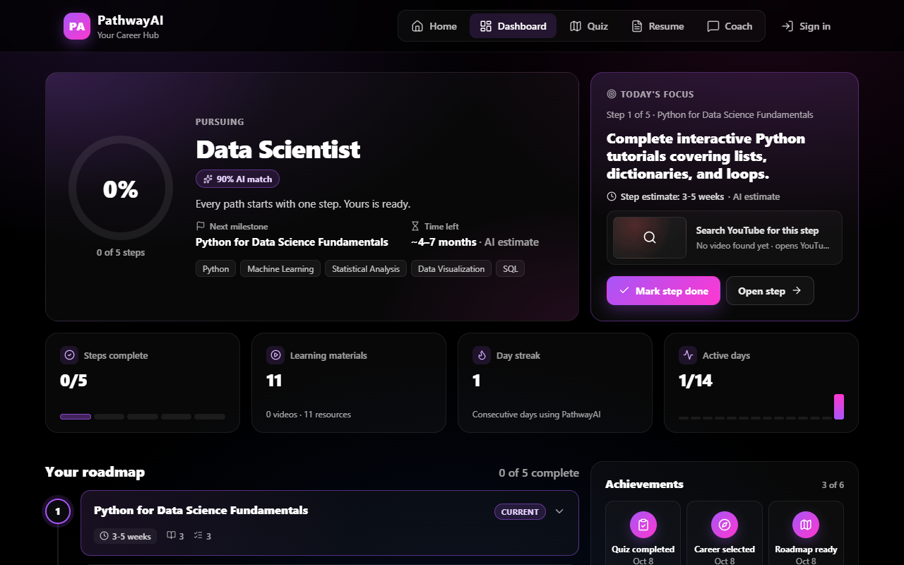
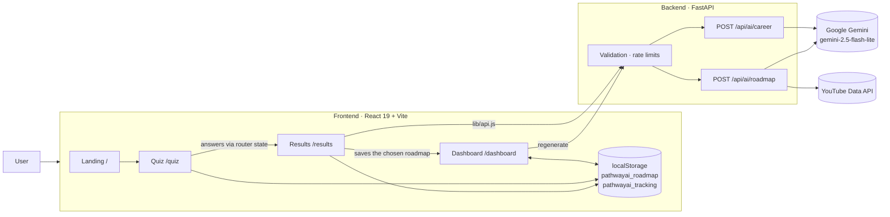

# PathwayAI

**AI-powered tech career guidance.** Answer a short quiz, get three personalized tech-career matches, and turn the one you pick into a step-by-step learning roadmap you can track.

> **Project status: early MVP.** The core flow (quiz → AI career matches → AI roadmap → progress dashboard) works end-to-end locally. Optional accounts (Supabase email + password) are built, and signed-in users' roadmaps and progress are saved to their account (Postgres); the resume analyzer and the AI coach are **planned, not built**. See [Roadmap](#roadmap) and [`ROADMAP.md`](ROADMAP.md).

---

## Screenshots

> _Placeholders — add images to `docs/screenshots/` and update the links._

| Landing | Quiz | Career matches | Dashboard |
|---|---|---|---|
|  |  |  |  |

---

## Features

### ✅ Implemented
- **Career quiz** — 5 quick questions (interests, problem-solving style, experience, weekly time, 12-month goal, plus an optional career in mind), under 2 minutes.
- **AI career matches** — Gemini suggests 3 technology careers with match %, salary range, growth outlook, education, key skills and a personalized reason.
- **Compare careers** — side-by-side comparison of 2–3 suggestions.
- **Regenerate** suggestions, or choose "None of these" to retake the quiz.
- **AI roadmap** — up to 5 actionable steps paced to the time you have each week, each with a time estimate, tasks, learning resources and up to 2 real YouTube videos (YouTube Data API; a search link when no key is configured).
- **Progress dashboard** — progress ring (steps done out of the roadmap's length), today's focus task, stat tiles, a visual step-by-step roadmap (expand, mark done/undo), dated achievements, rule-based insights and quick actions (regenerate the roadmap, retake the quiz). Every number comes from your own stored data.
- **Export** — download results as PDF or print.
- **Home hub (`/home`)** — quiz entry point, the roadmap saved in this browser with its real progress (or an honest empty state) and clearly labelled planned features.
- **Friendly 404 page** — unknown links show a branded page with ways back instead of a blank screen.
- **Persistence** — guests: the current roadmap and its progress survive reloads and new tabs (`localStorage`, this browser only). Signed-in users: roadmaps and progress are saved to their account and follow them across devices; a roadmap made as a guest can be saved to the account once, after sign-in.
- **Reliable AI output** — Gemini JSON mode with a response schema, per-item validation, one retry, and clear messages when the AI is busy or out of quota.
- **Optional accounts** — sign up / sign in with email + password (Supabase Auth, email confirmation), a `profiles` table protected by row-level security, and a backend that verifies Supabase access tokens (`GET /api/me`). Everything else still works as a guest; builds without Supabase configured simply hide accounts.

### 🟡 Partially implemented
- **Persistence** — the current roadmap and its progress are saved in this browser only (one roadmap at a time; not yet saved to your account).

### 🗺️ Planned
- Roadmaps saved to your account (PostgreSQL), shareable roadmap links
- Resume analysis and skill-gap detection
- AI career coach (chat)
- Streaming generation, grounded resources and real salary data
- Frontend tests, CI/CD, live deployment (the backend has 100 automated tests)

---

## Architecture



- The **frontend** is a single-page React app. Quiz answers move to Results through React Router navigation state; the chosen roadmap and its progress are saved in `localStorage`. Every backend call goes through one client, `src/lib/api.js`.
- The **backend** is a FastAPI service that holds the API keys server-side, validates and rate-limits requests, builds prompts, validates the model's JSON and adds real YouTube videos to roadmap steps.
- **Accounts** (optional) use Supabase: the browser signs in with the publishable key; the backend verifies access tokens locally against the project's public keys (ES256/JWKS). Postgres holds `profiles` and signed-in users' roadmaps, steps and progress, all protected by row-level security. AI-generated content is written only by the backend, as a least-privilege database role; the browser reads its own rows and records progress directly.

More: [`docs/architecture.md`](docs/architecture.md).

---

## AI workflow

1. **Career matching** — the quiz answers become a labelled profile (interests, problem-solving style, experience, weekly hours, 12-month goal, optional career in mind). Gemini returns exactly 3 **tech-industry** careers with `title, reason, match_score (70–95), salary_range, growth_rate, education, skills`, plus an `explanation`; each reason cites the user's answers.
2. **Roadmap generation** — the profile plus the chosen career produce ≤5 steps with `title, description, time, resources[{name,url}], tasks[]` and a video search phrase, paced to the weekly hours and ending at the goal. The backend turns the phrase into real videos with the YouTube Data API.
3. **Output handling** — Gemini JSON mode with a `response_schema`, then per-item Pydantic validation (defaults for missing fields, invalid items dropped) and at most one retry. Users get distinct messages for "busy", "usage limit" and failures; raw model output is never returned or logged.

Current limitations: no streaming, no caching, and salary figures and resource URLs are generated by the model, not retrieved from a verified source. See [`docs/ai-system.md`](docs/ai-system.md).

---

## Tech stack

| Layer | Technology |
|---|---|
| Frontend | React 19, Vite 7, React Router 7, framer-motion, lucide-react, html2pdf.js |
| Backend | Python, FastAPI, Uvicorn, Pydantic 2 |
| AI | Google Gemini (`google-genai` SDK, `gemini-2.5-flash-lite`) |
| Auth + DB | Supabase Auth (email + password), Supabase Postgres (`profiles`, roadmaps, RLS), PyJWT token verification, psycopg 3 |
| Storage | Browser `localStorage` for guests; Supabase Postgres for signed-in users |
| Tooling | ESLint 9, pytest (100 backend tests, no network) |

---

## Getting started

### Prerequisites
- Node.js 20+ and npm
- Python 3.11+
- A Google Gemini API key ([Google AI Studio](https://aistudio.google.com/))

### 1. Backend
```bash
cd backend
python -m venv .venv
# Windows: .venv\Scripts\activate   ·   macOS/Linux: source .venv/bin/activate
pip install -r requirements.txt
```
Copy `backend/.env.example` to `backend/.env` and set `GEMINI_API_KEY` (the example already allows the Vite dev origins in `ALLOWED_ORIGINS`). Run:
```bash
uvicorn main:app --reload --port 8000
```

### 2. Frontend
```bash
cd frontend
cp .env.example .env.local   # VITE_API_URL=http://127.0.0.1:8000
npm install
npm run dev                  # http://localhost:5173
```

### Environment variables
Nothing is hard-coded: every URL and key comes from these (full list and defaults in `docs/deployment.md`).

| Variable | Where | Required | Description |
|---|---|---|---|
| `GEMINI_API_KEY` | `backend/.env` | Yes | Google Gemini API key |
| `ALLOWED_ORIGINS` | `backend/.env` | Yes | Comma-separated frontend origins allowed by CORS |
| `YOUTUBE_API_KEY` | `backend/.env` | No | Real YouTube videos per roadmap step (otherwise a search link) |
| `RATE_LIMIT_PER_MINUTE`, `RATE_LIMIT_PER_DAY`, `GLOBAL_AI_LIMIT_PER_DAY` | `backend/.env` | No | AI endpoint rate limits (defaults 8 / 50 / 500) |
| `VITE_API_URL` | `frontend/.env.local` | Yes | Backend base URL; `npm run build` fails without it |
| `VITE_SUPABASE_URL`, `VITE_SUPABASE_PUBLISHABLE_KEY` | `frontend/.env.local` | No | Supabase project URL + publishable key; without them accounts are hidden |
| `SUPABASE_URL` | `backend/.env` | No | Same project URL; lets the API verify sign-in tokens |


### Scripts
| Command | Description |
|---|---|
| `npm run dev` | Start the Vite dev server |
| `npm run build` | Production build to `dist/` (needs `VITE_API_URL`) |
| `npm run preview` | Preview the production build |
| `npm run lint` | Run ESLint |
| `cd backend && pip install -r requirements-dev.txt && python -m pytest -q` | Backend tests (fake Gemini, no keys or network needed) |

---

## Deployment

Not deployed yet, but ready for [Render](https://render.com): `render.yaml` is a Blueprint for the FastAPI service (health check `/health`) and the static React site. The backend validates requests, rate-limits the AI endpoints (per IP and globally), returns generic error messages and never logs quiz answers. See [`docs/deployment.md`](docs/deployment.md).

---

## Folder structure

```
roadmap-ai/
├── backend/
│   ├── main.py              # FastAPI app, middleware, endpoints
│   ├── config.py            # settings from environment variables
│   ├── schemas.py           # Pydantic request models (quiz answers)
│   ├── prompts.py           # prompt builders
│   ├── llm.py               # Gemini client: JSON mode, retries, safe logs
│   ├── ai_output.py         # AI output validation
│   ├── rate_limit.py        # in-memory rate limiter
│   ├── request_log.py       # request IDs in logs
│   ├── youtube.py           # YouTube Data API lookups
│   ├── auth.py              # Supabase access-token verification
│   ├── tests/               # pytest suite (fake Gemini)
│   └── requirements.txt
├── frontend/
│   └── src/
│       ├── pages/           # Landing, Home, Quiz, Results, Dashboard, Login
│       ├── components/      # AppHeader, AuthProvider, Dialog, VideoCard, CareerCompareModal, ShareModal, dashboard/*
│       ├── lib/             # api (backend client), supabase + authContext, roadmapStore, dashboardData, trackingEngine, roadmaps/, resume/
│       ├── data/            # quiz questions, tracking schema, career details
│       └── index.css        # global styles
├── supabase/migrations/     # database migrations (Supabase CLI format)
├── render.yaml              # Render Blueprint (not deployed yet)
├── docs/                    # architecture, API, AI, design, decisions (ADRs)…
├── CLAUDE.md                # project memory for AI-assisted development
├── ROADMAP.md
└── SESSION.md
```

---

## Technical decisions

Key choices and their trade-offs are recorded as ADRs in [`docs/decisions.md`](docs/decisions.md). Highlights:
- **FastAPI proxy for AI** keeps the API key off the client and gives one place for validation, rate limiting and caching.
- **Gemini Flash-Lite** was chosen for low latency and low cost on structured, short outputs.
- **localStorage first** made an account-free MVP possible. **Supabase** (ADR-018) adds optional accounts, and since Milestone 2 (ADR-019) signed-in users' roadmaps live in Postgres, written by the backend as a least-privilege role and protected by row-level security.
- **Tech-only scope**: the product narrowed from general careers to technology careers to give deeper, more accurate guidance.

---

## Roadmap

Short version (full, estimated and prioritized: [`ROADMAP.md`](ROADMAP.md)):
1. **Foundation:** version control, cleanup, env config, bug fixes, AI output validation, backend hardening
2. **Production baseline:** tests, CI, Docker, deployment, error tracking
3. **Persistence:** auth, PostgreSQL, saved and shareable roadmaps
4. **AI depth:** streaming, grounded resources (RAG), resume analysis, evaluation harness
5. **Differentiators:** AI coach with tool calling, job-market data, mock interviews, EN/FR

---

## Documentation

| Doc | Contents |
|---|---|
| [`docs/architecture.md`](docs/architecture.md) | System overview and data flow |
| [`docs/frontend.md`](docs/frontend.md) | Pages, components, state, styling |
| [`docs/backend.md`](docs/backend.md) | FastAPI service |
| [`docs/api.md`](docs/api.md) | Endpoint reference |
| [`docs/ai-system.md`](docs/ai-system.md) | Prompts, parsing, planned AI improvements |
| [`docs/database.md`](docs/database.md) | Current storage and planned schema |
| [`docs/ui-design.md`](docs/ui-design.md) | Design language and UI backlog |
| [`docs/testing.md`](docs/testing.md) | Tests and test strategy |
| [`docs/deployment.md`](docs/deployment.md) | Render deployment steps and checklist |
| [`docs/decisions.md`](docs/decisions.md) | Architecture Decision Records |
| [`docs/technical-debt.md`](docs/technical-debt.md) | Known issues by severity |
