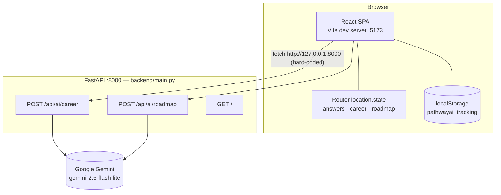
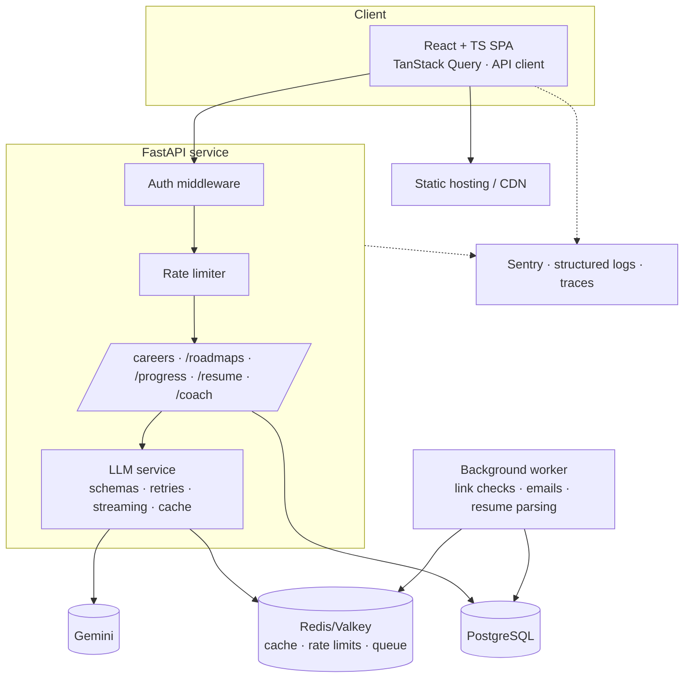

# Architecture

> Status legend: ✅ implemented · 🟡 partial · 🗺️ planned

## Current system (✅)

### Components
| Component | Responsibility | Notes |
|---|---|---|
| React SPA | All UI, routing, quiz state, rendering AI output, tracking and scoring | Plain JS; no API layer; no global state library |
| Router state | Moves `answers` Quiz → Results; a fallback copy of `{career, roadmap}` Results → Dashboard | Since 2026-09-26 the dashboard reads the roadmap from localStorage first (ADR-013) |
| Roadmap store | `pathwayai_roadmap`: the current roadmap with careerData and answers | One roadmap, this browser only (`lib/roadmapStore.js`) |
| localStorage | Event log, metrics history, step progress | Single key `pathwayai_tracking`; unbounded growth; rewritten on every read |
| FastAPI | Holds the Gemini key; builds prompts; parses JSON; returns results | Stateless; no auth, rate limit, validation or caching |
| Gemini | Generates careers and roadmaps | Prompt-and-parse JSON; no response schema |

### Request lifecycle — career matches
1. `Quiz` collects answers → `navigate("/results", { state: { answers } })`.
2. `Results` `useEffect` → `POST /api/ai/career` with `AbortController`.
3. Backend formats `key: value` lines → prompt → `client.models.generate_content` → strips code fences → `json.loads` → returns the dict.
4. `Results` stores `{explanation, careers}` and tracks `career_suggestions_generated`.

### Request lifecycle — roadmap
1. User picks a career → `POST /api/ai/roadmap {answers, career}`.
2. Response `roadmap[]` normalized (adds `step`, defaults `time/resources/tasks`).
3. `saveCurrentRoadmap(...)` writes `pathwayai_roadmap`, then `navigate("/dashboard", { state: { career, roadmap } })`.
4. `Dashboard` loads the stored roadmap and derives everything in `lib/dashboardData.js`; marking a step done writes `progress["roadmap_step_<roadmapId>_<index>"]` and a `roadmap_step_completed` event.

## Known architectural problems
- No data ownership: the roadmap exists only in router state.
- Progress is global, not per roadmap (keys collide across careers).
- Hard-coded origins/URLs prevent any deployment.
- Two competing theme mechanisms (`ThemeGate` and per-page `useEffect` body classes).
- ~~Two dashboard designs~~ — resolved 2026-09-25 (ADR-010): the unrouted `/app/*` shell was deleted; the tabbed `/dashboard` is the roadmap view and `/home` is the future signed-in hub.
- The backend is an open proxy to a paid API.

## Target architecture (🗺️)

Principles for the target:
- The server owns user data (roadmaps, progress). The client caches it.
- Every LLM call goes through one service layer: prompt versioning, schema validation, retries, caching, token/cost logging.
- Config comes entirely from the environment. The same image runs in dev, staging and prod.
- Record architecture changes as ADRs in `docs/decisions.md`.
