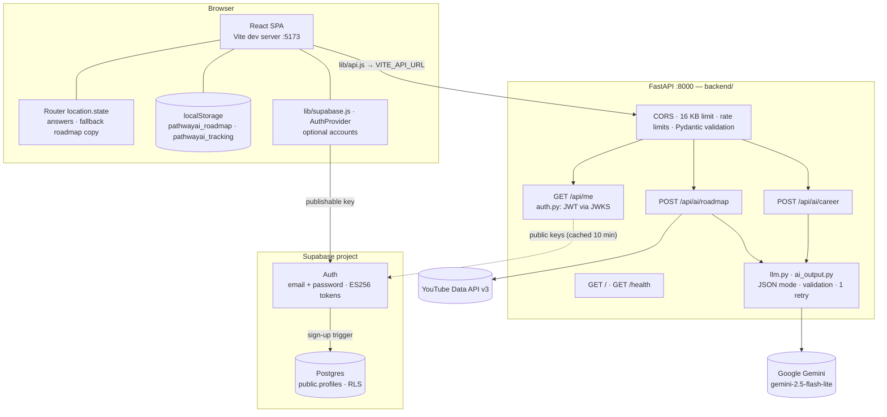
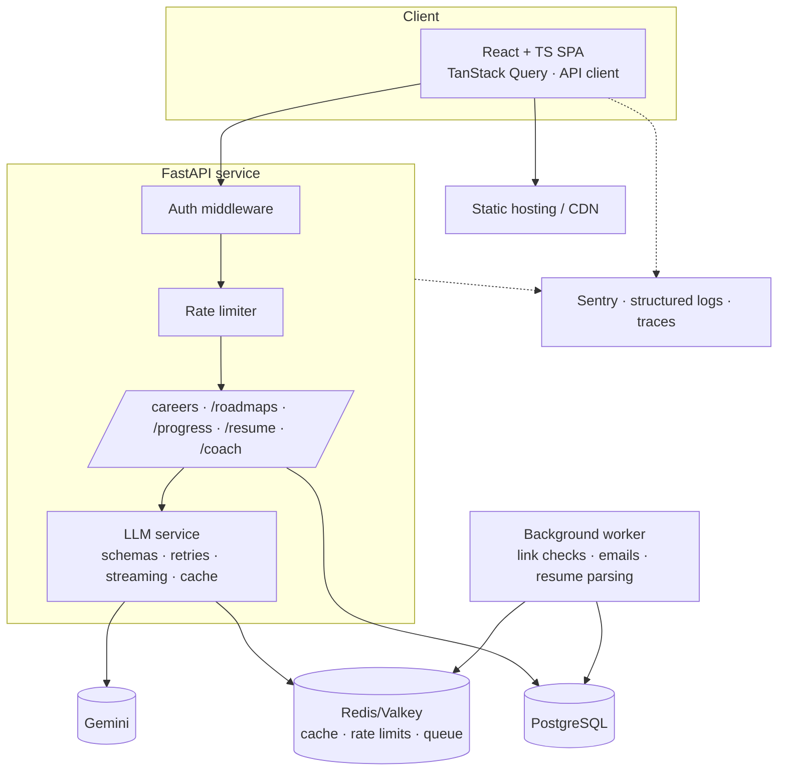

# Architecture

> Status legend: ✅ implemented · 🟡 partial · 🗺️ planned

## Current system (✅)

### Components
| Component | Responsibility | Notes |
|---|---|---|
| React SPA | All UI, routing, quiz state, rendering AI output, tracking | Plain JS; one API client (`lib/api.js`); no global state library |
| Router state | Moves `answers` Quiz → Results; a fallback copy of `{career, roadmap}` Results → Dashboard | Since 2026-09-26 the dashboard reads the roadmap from localStorage first (ADR-013) |
| Roadmap store (guests) | `pathwayai_roadmap`: the current roadmap with careerData and answers | One roadmap, this browser only (`lib/roadmapStore.js`), reached through `lib/roadmaps/localRepository.js` |
| Saved roadmaps (signed in) | The account's roadmaps, steps and progress | Supabase Postgres (ADR-019): read and progress-written by the browser through RLS (`lib/roadmaps/accountRepository.js`); generated, regenerated and imported by FastAPI as `pathwayai_api` |
| Tracking store | Event log, metrics history, step progress | `pathwayai_tracking`; unbounded growth; rewritten on every read (TD-27) |
| Accounts (optional) | Email + password sign-in/up in the browser; session in `AuthProvider` (`useAuth()`) | Supabase Auth via `lib/supabase.js` with the publishable key (ADR-018). Off when the `VITE_SUPABASE_*` variables are unset. Signed-in users' roadmaps live in the account since 2026-10-03 (ADR-019) |
| FastAPI | Holds the API keys; validates requests; rate limits; builds prompts; validates AI output; adds YouTube videos; verifies Supabase tokens on `/api/me` and `/api/roadmaps*`; saves signed-in users' roadmaps (`db.py`, `repositories/`, `routers/`) | Config from env (`config.py`); Pydantic request models (ADR-014); output validation + one retry (ADR-015); in-memory rate limits; AI routes need no token (guests) |
| Supabase | Auth users + `public.profiles` (RLS, sign-up trigger) + roadmap tables (`quiz_submissions`, `roadmaps`, `roadmap_steps`, `step_progress`; RLS; role `pathwayai_api` via the transaction pooler) | Project `pczczkmkavmxibxureck`; migrations in `supabase/migrations/` |
| Gemini | Generates careers and roadmaps | JSON mode + `response_schema` (ADR-015) |
| YouTube Data API | Real videos per roadmap step | Optional `YOUTUBE_API_KEY`; search-link fallback (ADR-012) |

### Request lifecycle — career matches
1. `Quiz` collects answers → `navigate("/results", { state: { answers } })`.
2. `Results` `useEffect` → `POST /api/ai/career` with `AbortController`.
3. Backend validates the answers (5-question v2 format, or the old 8-question v1 format for saved roadmaps; ADR-016), builds a labelled profile (v2) or `key: value` lines (v1) → prompt → `llm.generate` (Gemini JSON mode + response schema, ≤2 attempts) → `ai_output.parse_careers` validates each career → returns the validated dict.
4. `Results` stores `{explanation, careers}` and tracks `career_suggestions_generated`.

### Request lifecycle — roadmap
1. User picks a career → `POST /api/ai/roadmap {answers, career}`.
2. Response `roadmap[]` normalized (adds `step`, defaults `time/resources/tasks`).
3. `saveCurrentRoadmap(...)` writes `pathwayai_roadmap`, then `navigate("/dashboard", { state: { career, roadmap } })`.
4. `Dashboard` loads the stored roadmap and derives everything in `lib/dashboardData.js`; marking a step done writes `progress["roadmap_step_<roadmapId>_<index>"]` and a `roadmap_step_completed` event.

## Known architectural problems
- ~~The roadmap exists only in router state; progress keys collide across careers~~ — resolved 2026-09-26 (ADR-013). Guests: still one roadmap per browser. Signed-in users: roadmaps in Postgres since 2026-10-03 (Milestone 2, ADR-019).
- ~~Hard-coded origins/URLs prevent any deployment~~ — resolved 2026-09-27 (ADR-014).
- ~~Two competing theme mechanisms~~ — since 2026-10-08 one dark theme: `<body class="theme-landing">` in `index.html` (N-10).
- ~~Two dashboard designs~~ — resolved 2026-09-25 (ADR-010): the unrouted `/app/*` shell was deleted; the tabbed `/dashboard` is the roadmap view and `/home` is the future signed-in hub.
- The backend is an unauthenticated proxy to a paid API; since 2026-09-27 rate limits and input limits bound the spend (ADR-014). Rate limits and the YouTube cache live in process memory (reset on restart, not shared between instances).

## Target architecture (🗺️)

Principles for the target:
- The server owns user data (roadmaps, progress). The client caches it.
- Every LLM call goes through one service layer: prompt versioning, schema validation, retries, caching, token/cost logging.
- Config comes entirely from the environment. The same image runs in dev, staging and prod.
- Record architecture changes as ADRs in `docs/decisions.md`.
