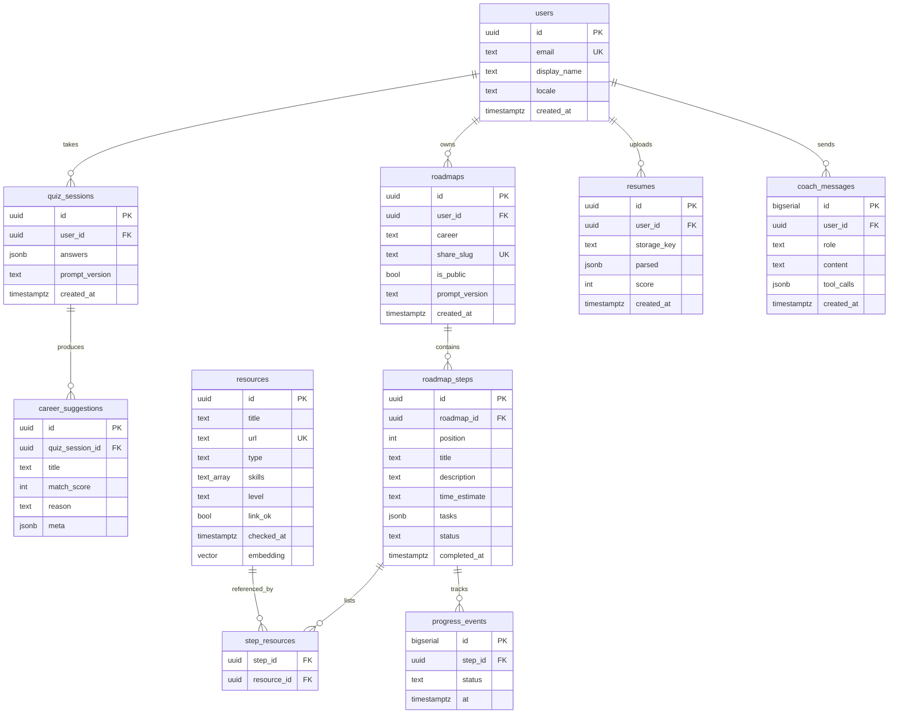

# Data & Database

## Current state (✅): no database

All persistence is **client-side**, in two `localStorage` keys: `pathwayai_roadmap` (the current roadmap, since 2026-09-26, ADR-013) and `pathwayai_tracking` (events, metrics, progress).

### `pathwayai_roadmap` (`lib/roadmapStore.js`)
```jsonc
{
  "version": 1,
  "id": "m1abcxyz12",            // new id per generated roadmap; scopes the progress keys
  "career": "Data Analyst",
  "careerData": { /* the chosen career card: match_score, salary_range, skills… */ },
  "answers": { /* the quiz answers (v2, or v1 for older roadmaps), used by Regenerate */ },
  "roadmap": [ { "title": "…", "time": "…", "tasks": [], "resources": [], "videos": [], "video_search_url": "…" } ],
  "generatedAt": 1727…
}
```
One roadmap at a time: generating a new one replaces it. A record with another version, no id or an empty roadmap is treated as "no roadmap" (the dashboard shows its empty state).

### `pathwayai_tracking` (`lib/trackingEngine.js`)

```jsonc
{
  "version": "1.0.0",
  "events":   [ { "id": "1727…_ab12cd34", "type": "quiz_completed", "payload": { … }, "timestamp": 1727… } ],
  "metrics":  { "resume_score": { "values": [{ "value": 72, "timestamp": … }], "current": 72, "average": 72, "max": 72, "min": 72, "lastUpdated": … } },
  "progress": { "roadmap_step_<roadmapId>_0": { "started": null, "completed": 1727…, "skipped": false, "attempts": 0, "lastStatus": "completed", "lastUpdated": …, "metadata": {} } },
  "sessionStartTime": …, "lastSessionStart": …, "totalSessions": 3,
  "totalScreensViewed": 41,   // ⚠ incremented on every event, not screens
  "actionsCompleted": 41
}
```

- Event types and metric names: `frontend/src/data/trackingSchema.js` (the string values are a persistence contract).
- `validateEvent` checks required payload fields only.
- The `resume_score` metric in the example above is only written by the deleted simulated analyzer; no shipped code writes it now.
- **Not stored:** the 3 career suggestions (they live in React Router `location.state` on `/results` only).

### Problems
- ~~Progress keys aren't scoped to a roadmap~~ — fixed 2026-09-26: keys are `roadmap_step_<roadmapId>_<index>` (ADR-013). Old unscoped keys are ignored, not migrated.
- One roadmap per browser; a new roadmap replaces the previous one (B-20 would keep several).
- `events[]` grows forever. `getTrackingData()` parses and **re-writes** the whole blob on every read.
- `quiz_completed` and per-question events store raw answers in the browser, and `pathwayai_roadmap` stores the answers, including the optional "career in mind" text (TD-41).
- No sync across devices; clearing site data wipes everything.
- The ~5 MB localStorage quota will eventually be reached, and failures are only logged to the console.

## Short-term plan (🗺️, B-18/B-20)
The current roadmap is persisted (above). Still planned before accounts: several saved roadmaps and a capped event log, for example:
```jsonc
{
  "version": "2.0.0",
  "roadmaps": { "<roadmapId>": { "career": "…", "createdAt": …, "steps": [ … ] } },
  "activeRoadmapId": "<roadmapId>",
  "progress": { "<roadmapId>": { "<stepIndex>": { "status": "completed", "updatedAt": … } } },
  "events": [ /* capped, e.g. last 500 */ ]
}
```
Include a migration from v1 (drop or ignore old unscoped `roadmap_step_*` keys).

## Target schema (🗺️) — PostgreSQL



Notes:
- Migrations: Alembic. ORM: SQLAlchemy 2 / SQLModel.
- `pgvector` for `resources.embedding` (RAG).
- Index `roadmaps(user_id)`, `roadmap_steps(roadmap_id, position)`, `progress_events(step_id, at)`.
- Scores (readiness and momentum) are computed server-side from `progress_events`, not stored.
- Privacy: support account deletion (cascade) and export; keep answers out of logs.
- Product analytics events go to an analytics tool (e.g. PostHog), not the primary DB.
